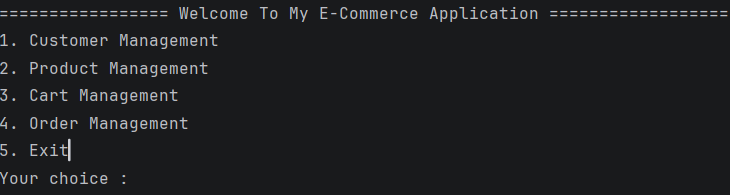
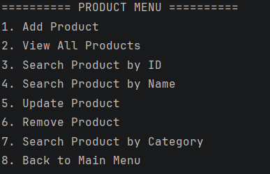

# E-Commerce Console Application

## Project Overview

The E-Commerce Console Application is a menu-driven application developed using Core Java. It simulates basic e-commerce operations, allowing customers to browse products, manage shopping carts, and place and manage orders.

The project focuses on implementing Object-Oriented Programming (OOP) principles, Java Collections Framework, Stream API, and modular application architecture.

## Technologies Used

- **Programming Language:** Java
- **Build Tool:** Maven
- **Core Concepts:** OOP, Encapsulation, Inheritance, Polymorphism
- **Collections Framework:** ArrayList
- **Java Features:** Stream API, Lambda Expressions
- **IDE:** IntelliJ IDEA
- **Version Control:** Git and GitHub

## Application Features

### 1. Customer Management

- Register new customers
- Customer login
- View customer details
- Search customers by ID
- Manage customer information

### 2. Product Management

- Add new products
- View all products
- Search products by ID
- Update product details
- Filter products by category
- Check product availability
- Increase and decrease product stock

### 3. Shopping Cart Management

- Create a shopping cart for customers
- Add products to the cart
- Update cart item quantities
- Remove products from the cart
- Clear shopping cart
- View cart details
- Calculate total cart amount
- Validate product availability and stock quantity

### 4. Order Management

- Place customer orders
- View all orders
- View customer orders
- Search orders by status
- View pending orders
- View cancelled orders
- Cancel orders
- Calculate total revenue from delivered orders

## Project Architecture

The application follows a layered architecture to separate data models, business logic, and utility operations.

```text
e-commerce-web-project/
│
├── docs/
│   └── projectHerarchy
│
├── src/
│   ├── main/
│   │   └── java/
│   │       └── org/src/
│   │           ├── model/
│   │           ├── service/
│   │           ├── util/
│   │           └── Main.java
│   │
│   └── screenshots/
│       ├── main-menu.png
│       ├── product-menu.png
│       ├── product-view.png
│       ├── cart-menu.png
│       └── order-menu.png
│
├── .gitignore
├── pom.xml
└── README.md
```

## Package Responsibilities

### Model Package

Contains the application's data classes, including Product, Customer, Electronics, Clothes, Glocery, Cart, CartItem, Order, OrderItem, and OrderStatus.

### Service Package

Contains business logic and application operations.

- **ProductService:** Handles product operations and stock management.
- **CustomerService:** Handles customer-related operations.
- **CartService:** Handles shopping cart operations and quantity validation.
- **OrderService:** Handles order placement, cancellation, and order-related operations.

### Utility Package

- **InputUtil:** Handles user input operations.

### Main Class

- **Main.java:** Entry point of the application. Handles the main menu and connects the different service classes.

## Application Workflow

1. Application starts from the Main class.
2. Customer registers or logs in.
3. Customer browses available products.
4. Customer creates a shopping cart.
5. Customer adds products to the cart.
6. Application validates product availability and stock.
7. Customer reviews the cart and total amount.
8. Customer places an order.
9. Application processes the order and updates product stock.
10. Customer can view or cancel eligible orders.

## Application Screenshots

### Main Menu



### Product Management



### Product List


### Cart Management


### Order Management


## How to Run the Project

### Prerequisites

- Java Development Kit (JDK)
- IntelliJ IDEA or another Java IDE
- Maven

### Steps

**1. Clone the repository**

```bash
git clone https://github.com/Nikhiltiwari2002/Java-Ecommerce-Management-System-Project.git
```

**2. Open the project**

Open the cloned project in IntelliJ IDEA.

**3. Configure JDK**

Make sure the JDK is properly configured in IntelliJ IDEA.

**4. Load Maven**

Allow IntelliJ IDEA to load and resolve the Maven dependencies.

**5. Run the application**

Navigate to `Main.java` and run the Main class.

## Key Learning Outcomes

- Practical implementation of Object-Oriented Programming.
- Understanding of Java Collections Framework.
- Working with ArrayList and Stream API.
- Using Lambda Expressions.
- Implementing business logic through service classes.
- Managing product inventory and shopping cart operations.
- Understanding order processing and management.
- Organizing Java applications using packages.
- Using Git and GitHub for version control.

## Future Enhancements

- Integrate Oracle Database using JDBC.
- Implement Spring Boot REST APIs.
- Develop a React-based frontend.
- Implement payment gateway integration.
- Add automated unit testing using JUnit.
- Implement secure customer authentication.

## Author

**Nikhil Tiwari**

Aspiring Java Developer

**Technical Skills:** Core Java | JDBC | Servlets | JSP | Hibernate | Spring Boot | Oracle SQL | React

**GitHub:** [Nikhil Tiwari](https://github.com/Nikhiltiwari2002)

**Project Repository:** [Java E-Commerce Management System](https://github.com/Nikhiltiwari2002/Java-Ecommerce-Management-System-Project)

---

This project is developed for learning and demonstrating practical Core Java development skills.
