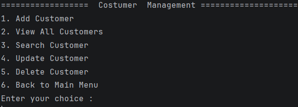
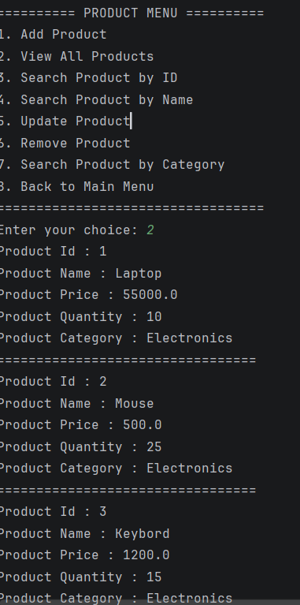
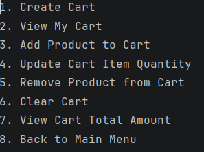
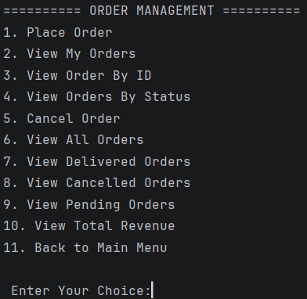
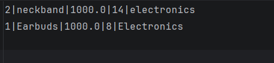
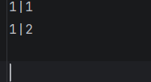
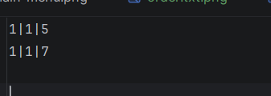
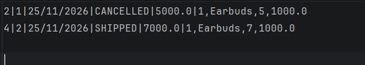

# E-Commerce Console Application

## Project Overview

The E-Commerce Console Application is a menu-driven application
developed using **Core Java**. It simulates basic e-commerce operations,
allowing customers to browse products, manage shopping carts, and place
and manage orders.

The project focuses on implementing Object-Oriented Programming (OOP)
principles, Java Collections Framework, Stream API, Lambda Expressions,
file handling, and modular application architecture.

## Technologies Used

-   **Programming Language:** Java
-   **Build Tool:** Maven
-   **Core Concepts:** OOP, Encapsulation, Inheritance, Polymorphism
-   **Collections Framework:** ArrayList
-   **Java Features:** Stream API, Lambda Expressions
-   **File Handling:** Java I/O and text-file-based data persistence
-   **IDE:** IntelliJ IDEA
-   **Version Control:** Git and GitHub

## Application Features

### 1. Customer Management

-   Register new customers
-   Customer login
-   View customer details
-   Search customers by ID
-   Update customer information
-   Delete customer records

### 2. Product Management

-   Add new products
-   View all products
-   Search products by ID and name
-   Update product details
-   Remove products
-   Filter products by category
-   Check product availability
-   Increase and decrease product stock

### 3. Shopping Cart Management

-   Create a shopping cart for customers
-   Add products to the cart
-   Update cart item quantities
-   Remove products from the cart
-   Clear the shopping cart
-   View cart details
-   Calculate the total cart amount
-   Validate product availability and stock quantity

### 4. Order Management

-   Place customer orders
-   View all orders
-   View customer orders
-   Search orders by ID
-   View orders by status
-   View pending orders
-   View delivered orders
-   View cancelled orders
-   Cancel eligible orders
-   Update order status
-   Calculate total revenue from delivered orders
-   Restore product stock when an eligible order is cancelled

### 5. File Handling and Data Persistence

The application uses Java file handling to save application data in text
files and load the saved records when the application starts.

-   Save and load product records using `product.txt`
-   Save and load customer records using `customer.txt`
-   Save and load cart records using `cart.txt`
-   Save and load cart item records using `cartItem.txt`
-   Save and load order records using `order.txt`
-   Persist order changes, including order status updates and
    cancellations
-   Update product stock records when orders are placed or cancelled

## Project Architecture

The application follows a layered architecture to separate data models,
business logic, and utility operations.

``` text
e-commerce-web-project/
│
├── docs/
│   └── projectHerarchy
│
├── src/
│   ├── main/
│   │   └── java/
│   │       └── org/src/
│   │           ├── model/
│   │           ├── service/
│   │           ├── util/
│   │           └── Main.java
│   │
│   └── screenshots/
│       ├── main-menu.png
│       ├── costumer-menu.png
│       ├── product-menu.png
│       ├── product-view.png
│       ├── cart-menu.png
│       ├── order-menu.png
│       ├── product.txt.png
│       ├── cart.txt.png
│       ├── cartItem.txt.png
│       └── order.txt.png
│
├── .gitignore
├── pom.xml
└── README.md
```

## Package Responsibilities

### Model Package

Contains the application's data classes, including `Product`,
`Customer`, `Electronics`, `Clothes`, `Glocery`, `Cart`, `CartItem`,
`Order`, `OrderItem`, and `OrderStatus`.

### Service Package

Contains business logic and application operations.

-   **ProductService:** Handles product operations and stock management.
-   **CustomerService:** Handles customer-related operations.
-   **CartService:** Handles shopping cart operations and quantity
    validation.
-   **OrderService:** Handles order placement, cancellation, status
    updates, and other order-related operations.

### Utility Package

-   **InputUtil:** Handles user input operations.
-   **FileUtil:** Provides reusable file and directory operations for
    reading and writing application data.

### Main Class

-   **Main.java:** Entry point of the application. Handles the main menu
    and connects the different service classes.

## Application Workflow

1.  The application starts from the `Main` class.
2.  Application data is loaded from the text files.
3.  The customer registers or logs in.
4.  The customer browses available products.
5.  The customer creates or opens a shopping cart.
6.  The customer adds products to the cart.
7.  The application validates product availability and stock.
8.  The customer reviews the cart and total amount.
9.  The customer places an order.
10. The application processes the order and updates product stock.
11. Order and product changes are saved to their respective text files.
12. The customer can view orders or cancel eligible orders.

## Screenshot Folder Location

All application screenshots are stored in the following project folder:

```text
D:\\java Course\\e-commerce-web-project\\src\\screenshots
```

Because `README.md` is located in the project root, use relative image paths beginning with `src/screenshots/`. For example:

```markdown

```

Keep the screenshot files inside `src/screenshots/` and commit that folder to GitHub so the images appear in the README.

## Application Screenshots

### Main Menu


### Customer Management



### Product Management


### Product List



### Cart Management



### Order Management



## File Handling Screenshots

These screenshots show examples of the text-file records used by the
application.

### Product Data



### Cart Data



### Cart Item Data



### Order Data



> **Note:** Do not publish screenshots or sample data containing real
> customer passwords, private information, or other sensitive details.
> The customer data screenshot is intentionally not included.

## How to Run the Project

### Prerequisites

-   Java Development Kit (JDK)
-   IntelliJ IDEA or another Java IDE
-   Maven
-   Git (optional, for cloning the repository)

### Steps

**1. Clone the repository**

``` bash
git clone https://github.com/Nikhiltiwari2002/Java-Ecommerce-Management-System-Project.git
```

**2. Open the project**

Open the cloned project in IntelliJ IDEA.

**3. Configure JDK**

Make sure the JDK is properly configured in IntelliJ IDEA.

**4. Load Maven**

Allow IntelliJ IDEA to load and resolve the Maven project.

**5. Run the application**

Navigate to `Main.java` and run the `Main` class.

## Key Learning Outcomes

-   Practical implementation of Object-Oriented Programming.
-   Understanding of the Java Collections Framework.
-   Working with ArrayList, Stream API, and Lambda Expressions.
-   Implementing business logic through service classes.
-   Managing product inventory and shopping cart operations.
-   Understanding order processing and order status management.
-   Implementing file handling and text-file-based data persistence.
-   Organizing Java applications using packages and layered
    architecture.
-   Using Git and GitHub for version control.

## Future Enhancements

-   Integrate Oracle Database using JDBC.
-   Implement Spring Boot REST APIs.
-   Develop a React-based frontend.
-   Implement payment gateway integration.
-   Add automated unit testing using JUnit.
-   Improve customer authentication and password security.

## Author

**Nikhil Tiwari**

Aspiring Java Developer

**Technical Skills:** Core Java \| JDBC \| Servlets \| JSP \| Hibernate
\| Spring Boot \| Oracle SQL \| React

**GitHub:** [Nikhil Tiwari](https://github.com/Nikhiltiwari2002)

**Project Repository:** [Java E-Commerce Management
System](https://github.com/Nikhiltiwari2002/Java-Ecommerce-Management-System-Project)

------------------------------------------------------------------------

This project is developed for learning and demonstrating practical Core
Java development skills.
